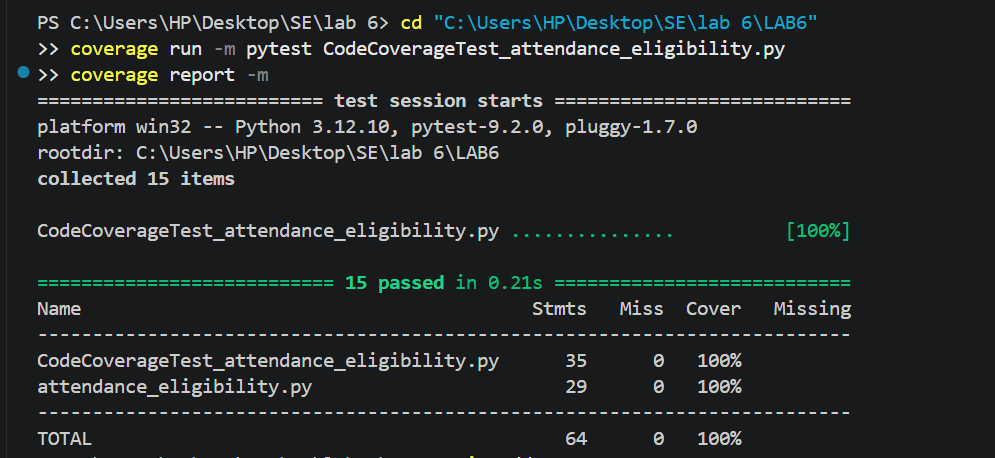
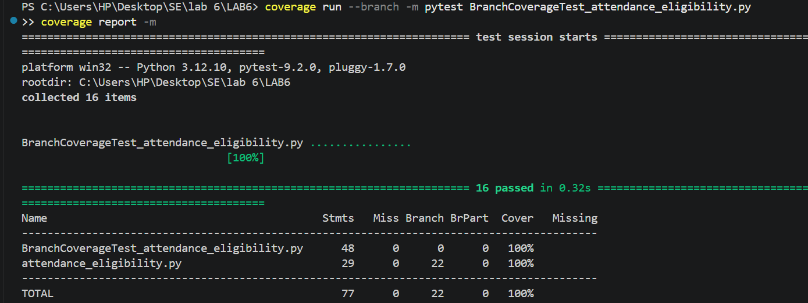

# L6_L7_62 — Attendance Eligibility

This repository contains the implementation, test suites, and analysis for **Lab 6 (Code and Branch Coverage Analysis)** and **Lab 7 (Fuzzing for Input Validation Bugs)** on the attendance eligibility modules.

---

## 📌 Objectives

### Lab 6: Code and Branch Coverage Analysis
- Understand the practical difference between **Code Coverage (Line Coverage)** and **Branch Coverage**.
- Use Python's `coverage` library with `pytest` to measure, report, and maximize test coverage.
- Address decision structures, boundary values, and edge cases to achieve ≥ 90% (achieved 100%) code and branch coverage.

### Lab 7: Fuzzing for Input Validation Bugs
- Use **Hypothesis** property-based fuzzing with `pytest` to uncover input validation crashes on malformed, empty, `None`, and arbitrary text inputs.
- Harden the attendance eligibility parser functions (`normalize_srn`, `attendance_from_ratio`, `attendance_from_register`) so they handle any input gracefully without crashing.

---

## 📁 Repository Structure

```text
.
├── README.md                                           # Root Documentation
├── .gitignore                                          # Git ignore file
├── LAB6/
│   ├── README.md                                       # Lab 6 Specific Details
│   ├── attendance_eligibility.py                       # Source module under test
│   ├── test_attendance_eligibility.py                  # Synchronized test suite
│   ├── CodeCoverageTest_attendance_eligibility.py      # Deliverable: 100% Code Coverage tests
│   ├── BranchCoverageTest_attendance_eligibility.py    # Deliverable: 100% Branch Coverage tests
│   ├── code_coverage.png                               # Screenshot: Code Coverage terminal output
│   └── branch_coverage.png                             # Screenshot: Branch Coverage terminal output
└── LAB7/
    ├── README.md                                       # Lab 7 Specific Details
    ├── attendance_eligibility_parser.py                # Fixed module with input validation
    ├── test_attendance_eligibility_parser.py           # Hypothesis fuzzing tests
    └── PES2UG25CS826_LAB-7.pdf                         # Deliverable: Screenshots (SS1–SS4) & reflection answers
```

---

## ⚙️ Installation & Requirements

Ensure Python 3.x is installed, then install the required dependencies:

```bash
pip install coverage pytest hypothesis
```

---

## 🧪 Lab 6: Code and Branch Coverage Analysis

### 1. Code Coverage Analysis

Code coverage measures how many executable statements were visited during test execution.

**Run Code Coverage:**
```bash
cd LAB6
coverage run -m pytest CodeCoverageTest_attendance_eligibility.py
coverage report -m
```

**Results:**
- **Statements Tested:** 64
- **Missed Statements:** 0
- **Coverage Achieved:** 100%

```text
Name                                          Stmts   Miss  Cover   Missing
---------------------------------------------------------------------------
CodeCoverageTest_attendance_eligibility.py       35      0   100%
attendance_eligibility.py                        29      0   100%
---------------------------------------------------------------------------
TOTAL                                            64      0   100%
```



### 2. Branch Coverage Analysis

Branch coverage evaluates whether every decision branch (e.g., each `if`, `elif`, `else` outcome) evaluated to both `True` and `False`.

**Run Branch Coverage:**
```bash
cd LAB6
coverage run --branch -m pytest BranchCoverageTest_attendance_eligibility.py
coverage report -m
```

**Results:**
- **Statements:** 77
- **Total Branches:** 22
- **Partial / Missed Branches:** 0
- **Coverage Achieved:** 100%

```text
Name                                            Stmts   Miss Branch BrPart  Cover   Missing
-------------------------------------------------------------------------------------------
BranchCoverageTest_attendance_eligibility.py       48      0      0      0   100%
attendance_eligibility.py                          29      0     22      0   100%
-------------------------------------------------------------------------------------------
TOTAL                                              77      0     22      0   100%
```



---

## 🔍 Lab 7: Fuzzing for Input Validation Bugs

### 1. Input Validation Fixes (`attendance_eligibility_parser.py`)

All three parser functions validate input types and malformed values instead of crashing:
- `normalize_srn(srn)` — returns `""` for non-string inputs; strips whitespace, removes spaces, and converts to uppercase.
- `attendance_from_ratio(text)` — validates string type, `ATTENDED/HELD` split format, integer parsing (`ValueError`/`TypeError`), and bounds (`attended < 0`, `held <= 0`, `attended > held`), returning `0` on invalid input.
- `attendance_from_register(marks)` — validates string type, non-empty input, and ensures all characters are `'P'` or `'A'`, returning `0` on invalid input.

### 2. Hypothesis Fuzz Testing (`test_attendance_eligibility_parser.py`)

Property-based fuzz tests using `@given(st.text() | st.none())` verify no crashes across:
- `test_normalize_srn_no_crash`
- `test_attendance_from_ratio_no_crash`
- `test_attendance_from_register_no_crash`

**Run Interactive CLI & Fuzz Tests:**
```bash
cd LAB7
python attendance_eligibility_parser.py
pytest test_attendance_eligibility_parser.py
```

---

## 📋 Deliverables Summary

| Lab | Deliverable | File / Artifact | Status |
|-----|-------------|-----------------|--------|
| Lab 6 | Code Coverage Test Suite | [LAB6/CodeCoverageTest_attendance_eligibility.py](https://github.com/sohel832/L6_L7_62_attendance_eligibility/blob/main/LAB6/CodeCoverageTest_attendance_eligibility.py) | ✅ 100% Achieved |
| Lab 6 | Branch Coverage Test Suite | [LAB6/BranchCoverageTest_attendance_eligibility.py](https://github.com/sohel832/L6_L7_62_attendance_eligibility/blob/main/LAB6/BranchCoverageTest_attendance_eligibility.py) | ✅ 100% Achieved |
| Lab 6 | Code Coverage Screenshot | [LAB6/code_coverage.png](https://github.com/sohel832/L6_L7_62_attendance_eligibility/blob/main/LAB6/code_coverage.png) | ✅ Verified |
| Lab 6 | Branch Coverage Screenshot | [LAB6/branch_coverage.png](https://github.com/sohel832/L6_L7_62_attendance_eligibility/blob/main/LAB6/branch_coverage.png) | ✅ Verified |
| Lab 7 | Fixed Parser Module | [LAB7/attendance_eligibility_parser.py](https://github.com/sohel832/L6_L7_62_attendance_eligibility/blob/main/LAB7/attendance_eligibility_parser.py) | ✅ Completed |
| Lab 7 | Hypothesis Fuzz Tests | [LAB7/test_attendance_eligibility_parser.py](https://github.com/sohel832/L6_L7_62_attendance_eligibility/blob/main/LAB7/test_attendance_eligibility_parser.py) | ✅ Completed |
| Lab 7 | Lab 7 Report PDF (SS1–SS4 & Answers) | [LAB7/PES2UG25CS826_LAB-7.pdf](https://github.com/sohel832/L6_L7_62_attendance_eligibility/blob/main/LAB7/PES2UG25CS826_LAB-7.pdf) | ✅ Uploaded |
| Repo | Commit History | ≥ 2 Commits on GitHub | ✅ Verified |

---

## 👥 Authors

- **Student:** Sohel ([@sohel832](https://github.com/sohel832))
- **Course:** Software Engineering Laboratory
