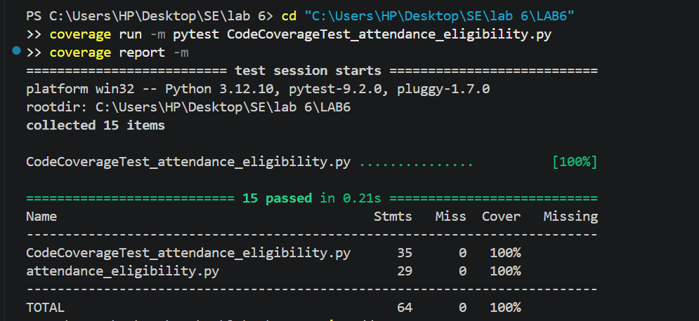
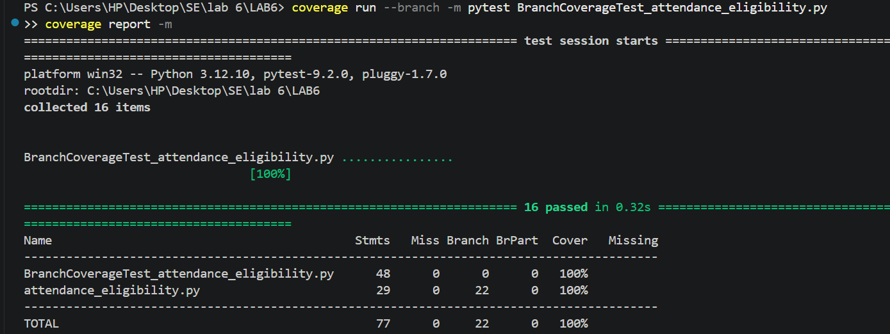

# Lab 6: Code and Branch Coverage Analysis

[](#code-coverage-analysis)
[](#branch-coverage-analysis)
[](https://www.python.org/)
[](https://docs.pytest.org/)

This repository contains the implementation, test suites, and analysis for **Lab 6: Code and Branch Coverage Analysis** on the `attendance_eligibility` module.

---

## 📌 Objectives

* Understand the practical difference between **Code Coverage (Line Coverage)** and **Branch Coverage**.
* Use Python's `coverage` library with `pytest` to measure, report, and maximize test coverage.
* Address decision structures, boundary values, and edge cases to achieve $\ge$ 90% (achieved **100%**) code and branch coverage.

---

## 📁 Repository Structure

```text
.
├── README.md                                          # Root Documentation
├── .gitignore                                         # Git ignore file
└── LAB6/
    ├── README.md                                      # Lab 6 Specific Details
    ├── attendance_eligibility.py                      # Source module under test
    ├── test_attendance_eligibility.py                 # Synchronized test suite
    ├── CodeCoverageTest_attendance_eligibility.py     # Deliverable: 100% Code Coverage tests
    ├── BranchCoverageTest_attendance_eligibility.py   # Deliverable: 100% Branch Coverage tests
    ├── code_coverage.png                              # Screenshot: Code Coverage terminal output
    └── branch_coverage.png                            # Screenshot: Branch Coverage terminal output
```

---

## ⚙️ Installation & Requirements

Ensure Python 3.x is installed, then install the required dependencies:

```bash
pip install coverage pytest
```

---

## 🧪 1. Code Coverage Analysis

Code coverage measures how many executable statements were visited during test execution.

### Run Code Coverage
```powershell
cd LAB6
coverage run -m pytest CodeCoverageTest_attendance_eligibility.py
coverage report -m
```

### Results
* **Statements Tested:** 64
* **Missed Statements:** 0
* **Coverage Achieved:** **100%**

```text
Name                                         Stmts   Miss  Cover   Missing
--------------------------------------------------------------------------
CodeCoverageTest_attendance_eligibility.py      35      0   100%
attendance_eligibility.py                       29      0   100%
--------------------------------------------------------------------------
TOTAL                                           64      0   100%
```

### Terminal Output Screenshot


---

## 🔀 2. Branch Coverage Analysis

Branch coverage evaluates whether every decision branch (e.g., each `if`, `elif`, `else` outcome) evaluated to both **True** and **False**.

### Run Branch Coverage
```powershell
cd LAB6
coverage run --branch -m pytest BranchCoverageTest_attendance_eligibility.py
coverage report -m
```

### Results
* **Statements:** 77
* **Total Branches:** 22
* **Partial / Missed Branches:** 0
* **Coverage Achieved:** **100%**

```text
Name                                           Stmts   Miss Branch BrPart  Cover   Missing
------------------------------------------------------------------------------------------
BranchCoverageTest_attendance_eligibility.py      48      0      0      0   100%
attendance_eligibility.py                         29      0     22      0   100%
------------------------------------------------------------------------------------------
TOTAL                                             77      0     22      0   100%
```

### Terminal Output Screenshot


---

## 📋 Deliverables Summary

| Deliverable | File / Artifact | Status |
| :--- | :--- | :---: |
| **Code Coverage Test Suite** | [`LAB6/CodeCoverageTest_attendance_eligibility.py`](LAB6/CodeCoverageTest_attendance_eligibility.py) | ✅ 100% Achieved |
| **Branch Coverage Test Suite** | [`LAB6/BranchCoverageTest_attendance_eligibility.py`](LAB6/BranchCoverageTest_attendance_eligibility.py) | ✅ 100% Achieved |
| **Code Coverage Screenshot** | [`LAB6/code_coverage.png`](LAB6/code_coverage.png) | ✅ Verified |
| **Branch Coverage Screenshot** | [`LAB6/branch_coverage.png`](LAB6/branch_coverage.png) | ✅ Verified |
| **Commit History** | $\ge$ 2 Commits on GitHub | ✅ Verified |

---

## 👥 Authors
* **Student:** Sohel ([@sohel832](https://github.com/sohel832))
* **Course:** Software Engineering Laboratory
